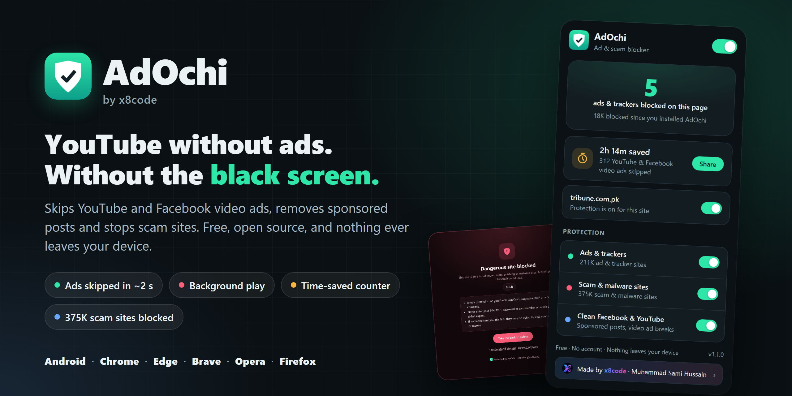
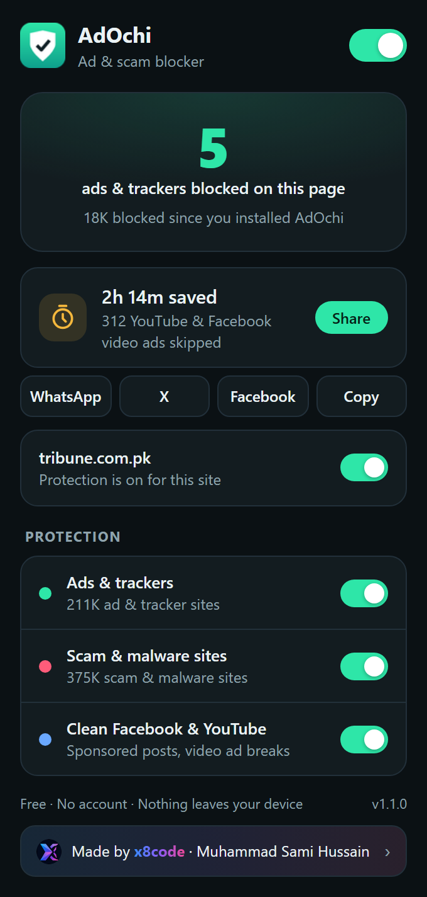
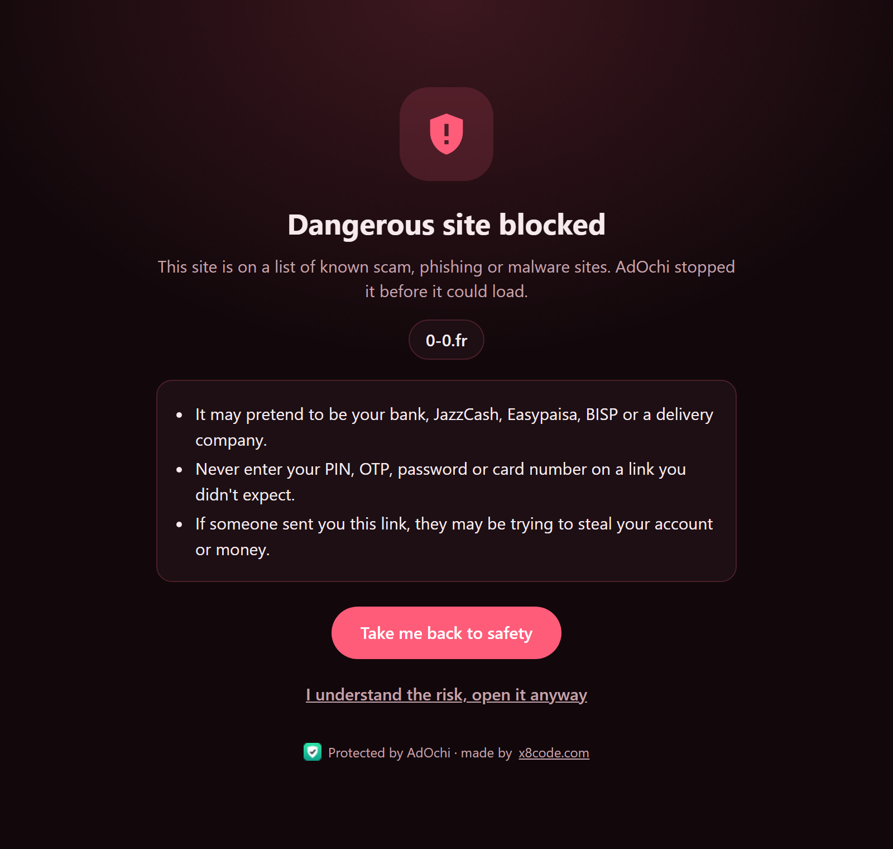

<div align="center">



# AdOchi

**Free ad, tracker and scam blocker for Android and every major browser.**<br>
YouTube without ads *and without the black screen*. Facebook without sponsored posts. Scam sites stopped before they load.<br>
No account. No servers. Nothing leaves your device.

[](https://github.com/sami-hussain-dev/AdOchi/releases/latest)
[](https://github.com/sami-hussain-dev/AdOchi/releases)
[](LICENSE)
[](https://github.com/sami-hussain-dev/AdOchi/stargazers)

### Download (one click)

<a href="https://github.com/sami-hussain-dev/AdOchi/releases/latest/download/AdOchi.apk"></a>
<a href="https://github.com/sami-hussain-dev/AdOchi/releases/latest/download/AdOchi-Extension-Chrome-Edge-Brave.zip"></a>
<a href="https://github.com/sami-hussain-dev/AdOchi/releases/latest/download/AdOchi-Extension-Firefox.zip"></a>

<sub>Each button downloads the newest version straight away. [How to install](#install-in-1-minute) · [All releases](https://github.com/sami-hussain-dev/AdOchi/releases)</sub>

</div>

---

## Why AdOchi?

In 2025–2026 YouTube started punishing ad blockers. When a blocker deletes the ads from the player's data, the video sits on a **black screen with a spinning circle** for as long as the ad would have run, or it never starts at all. That's why many blockers suddenly stopped working.

AdOchi 1.1 doesn't fight YouTube that way. It lets the ad load and then makes it vanish on the spot: muted, invisible, jumped to its end, and the *Skip* button pressed for you. YouTube sees a normal ad, so the video just plays.

**Measured in Chrome on the same videos (November 2026):**

| | Before the video starts |
|---|---|
| No blocker | 6 s + 66 s of ads |
| Blockers that delete YouTube's ad data (AdOchi 1.0 too) | **8–10 s black screen** (signed-in users report it never starting) |
| **AdOchi 1.1** | **No black screen.** Each ad gone in about 2 s, no ad → video at once |

And there's more than YouTube: fake ads and scam links are one of the main ways people lose their bank logins and OTP codes. AdOchi blocks them before they load, on your phone and in your browser.

## What's new in 1.1

- **YouTube works again.** No more black screen or "video won't play". Ads are skipped in about 2 seconds, and the *"Ad blockers are not allowed"* pop-up is removed.
- **Time saved counter.** See how much ad time AdOchi has skipped for you (*"2h 14m saved"*) and share it on WhatsApp, X or Facebook in one tap.
- **Background play (Android).** YouTube in AdOchi keeps playing with the screen off or while you use another app, with *Pause / Next / Close* in the notification. Great for naats, bayans, podcasts and music.
- **Home-screen shortcuts (Android).** Long-press the AdOchi icon for **YouTube (no ads)** and **Facebook (no ads)**, or drag them to your home screen.
- **Better Facebook video ad detection.** More ad-break wordings, including Urdu, and *"Sponsored · Paid for by …"* labels.

## Features

### 📱 Android app

| | |
|---|---|
| 🚫 **Blocks ads in every app, browser and game** | A local DNS filter with 210,000+ ad and tracker domains. |
| ▶️ **Clean Browser: YouTube, Facebook, Instagram, TikTok, X** | YouTube video ads skipped, Facebook *"Ad starting in 5"* breaks jumped over, sponsored posts removed. |
| 🎧 **Background play** | YouTube keeps playing with the screen off, with controls in the notification. |
| 🛡️ **Stops scam, phishing and malware sites** | 370,000+ domains, with an alert that names the app that tried to open one. |
| 🔍 **Phone scan** | Finds apps that can read your SMS/OTPs, control your screen (Accessibility), act as device admin or hide their icon. |
| 💬 **Message checks** | Share any WhatsApp or SMS message to AdOchi to see if its link is a scam. The *full* build checks new messages automatically. |
| 📊 **Privacy report and time saved** | Which apps try to track you, and how much ad time you got back. |
| 🎮 **Ad-free offline games** | Cut the internet for games that don't need it. |
| ⚙️ **More** | Default-browser mode, Quick Settings tile, encrypted DNS (DNS-over-HTTPS), light mode via Private DNS, weekly report. |

> **Why not inside the YouTube or Facebook apps?** Those apps load ads from the same servers as your videos and feed, so no blocker can remove them there without breaking the app. Open YouTube and Facebook *in AdOchi* (one tap with the home-screen shortcuts), and they're ad-free.

### 🧩 Browser extension (Chrome, Edge, Brave, Opera, Firefox)

<table>
<tr>
<td width="50%" valign="top">

- **Blocking:** the same ad, tracker and scam lists, run by the browser itself (Manifest V3 `declarativeNetRequest`), so it's fast.
- **YouTube without the black screen**, Facebook sponsored posts and video ad breaks removed.
- **Time saved** with one-tap sharing.
- **Scam warning page** instead of the dangerous site.
- **Popup controls:** blocked on this page, total, pause on one site, switch lists on and off.

</td>
<td width="50%" valign="top">

</td>
</tr>
</table>

<p align="center">

</p>

## Install in 1 minute

### Android

1. Tap **[Download APK](https://github.com/sami-hussain-dev/AdOchi/releases/latest/download/AdOchi.apk)** on your phone.
2. Open the downloaded file. If Android asks, allow *"Install unknown apps"* for your browser.
3. Open AdOchi and tap the big button. Android asks once to allow the VPN: that's the local filter, nothing goes to any server.

**Why two APKs?** `AdOchi.apk` is the one to share. `AdOchi-Full.apk` adds automatic Message Guard; it needs notification access, which Google Play Protect blocks for apps installed outside the Play Store.

### Chrome, Edge, Brave, Opera

Browsers only allow one-click installs from their own stores. Until AdOchi is listed there, it takes four steps:

1. **[Download the ZIP](https://github.com/sami-hussain-dev/AdOchi/releases/latest/download/AdOchi-Extension-Chrome-Edge-Brave.zip)** and unzip it (right-click → *Extract All*).
2. Open `chrome://extensions` (Edge: `edge://extensions`, Brave: `brave://extensions`).
3. Turn on **Developer mode** (top right; in Edge, bottom left).
4. Click **Load unpacked** and choose the unzipped folder, the one with `manifest.json` directly inside.

Pin AdOchi from the puzzle-piece menu so its counter is always visible.

> **Nothing happened, or the popup is empty?** You probably picked the ZIP file itself, or a folder one level too high. Pick the folder that contains `manifest.json`, `background.js` and `popup.html`.

### Firefox

1. **[Download the ZIP](https://github.com/sami-hussain-dev/AdOchi/releases/latest/download/AdOchi-Extension-Firefox.zip)**.
2. Open `about:debugging#/runtime/this-firefox` → **Load Temporary Add-on** → pick the ZIP file.

Firefox removes temporary add-ons when it closes. A signed version that stays installed is coming with the Firefox Add-ons listing.

<details>
<summary><b>Roman Urdu mein</b></summary>

**Android:** upar "Download APK" dabayein, file kholein, "Install unknown apps" ki ijazat dein, phir AdOchi khol kar bara button dabayein. YouTube aur Facebook ko AdOchi ke andar kholein (icon ko dabaye rakhein: "YouTube (no ads)"). Screen band ho tab bhi YouTube chalta rahega.

**Chrome / Edge:** ZIP download kar ke unzip karein → `chrome://extensions` kholein → "Developer mode" on karein → "Load unpacked" daba kar wo folder chunein jis ke andar `manifest.json` hai.

</details>

## Privacy

Everything runs on your device. AdOchi has no account, no analytics and no servers of its own.

- **Blocklists:** downloaded straight from their public sources.
- **Allowed lookups:** go to the public DNS resolver you choose.
- **Messages:** checked offline and never stored.
- **Time saved:** counted on your device. Sharing only happens when you tap *Share*.

## Building

### Android app

You need **JDK 17 or newer** (JDK 25 works with the bundled Gradle 9.1) and the Android SDK (compileSdk 36).

```bash
./gradlew assembleDirectDebug        # debug build, signed with the debug key
./gradlew testDirectDebugUnitTest    # unit tests (LiveListsTest needs internet)
node app/src/test/js/cleaner_test.js # page-cleaner checks
```

To build signed release APKs:

1. Create a keystore.
2. Copy `keystore.properties.example` to `keystore.properties` and fill it in.
3. Run:

```bash
./gradlew assembleDirectRelease assembleFullRelease
```

There are two product flavors:

- `direct`: no notification access. Use it for sharing as an APK.
- `full`: adds the notification-listener Message Guard.

### Browser extension

You need **Node.js 20+**.

```bash
node extension/tools/build.mjs           # downloads the lists, writes extension/dist/{chrome,firefox} + zips
node extension/tools/build.mjs --cached  # rebuild from lists downloaded earlier
node extension/test/e2e.mjs chrome       # loads it into headless Chrome and checks blocking, warning, popup
```

The build never blocks a list of essential sites (Google, Facebook, WhatsApp, YouTube, Pakistani
banks and wallets, government sites…), whatever a list says. It also fails if any core ad network is missing.
On YouTube pages, YouTube's own ad requests are let through on purpose: the page cleaner skips the ads, and blocking those requests is what triggers the black screen.

## Project layout

```
app/                     Android app (Kotlin, Jetpack Compose)
  src/main/java/com/adochi/
    core/                blocklists, filter engine, link inspector, phone scanner, stats
    vpn/                 local DNS tunnel, DNS-over-HTTPS, notifications, Quick Settings tile
    browser/             Clean Browser (WebView), background play, scam warning page
    guard/               Message Guard (full flavor)
    ui/                  screens and components
  src/main/assets/       cleaner.js (shared with the extension), media.js (app only) and built-in lists
  src/main/res/xml/      home-screen shortcuts
  src/full/              manifest additions for the full flavor
extension/
  src/                   extension source (manifest, background, popup, warning page)
  tools/build.mjs        list download + rule generation + packaging
  test/e2e.mjs           real-browser test
docs/                    README images and the download page
```

## Blocklists

AdOchi stands on the work of these free projects:

- [HaGeZi DNS blocklists](https://github.com/hagezi/dns-blocklists)
- [OISD](https://oisd.nl)
- [AdGuard DNS filter](https://github.com/AdguardTeam/AdGuardSDNSFilter)
- [StevenBlack hosts](https://github.com/StevenBlack/hosts)
- [Phishing Army](https://phishing.army)
- [malware-filter](https://gitlab.com/malware-filter)

Their licenses apply to the lists.

## Help AdOchi grow

- ⭐ **Star this repo.** It's the main way other people find it.
- 📤 Share your *time saved* from the popup or the app.
- 🐞 An ad got through? [Open an issue](https://github.com/sami-hussain-dev/AdOchi/issues/new) with the site and what you saw.

## License

AdOchi is free software under the [GNU General Public License v3.0](LICENSE). You may use, study,
share and change it. If you share a changed version, you must share its source under the same license.

## Made by x8code

<a href="https://x8code.com"></a>

**[x8code](https://x8code.com)** is a software house in Karachi, Pakistan. *Engineers who ship, not just estimate.*
Built by **Muhammad Sami Hussain**, Founder & Lead Software Engineer. More about him at [x8code.com/about](https://x8code.com/about).

Contact: [samihussain9t9@gmail.com](mailto:samihussain9t9@gmail.com) · [GitHub](https://github.com/sami-hussain-dev)
